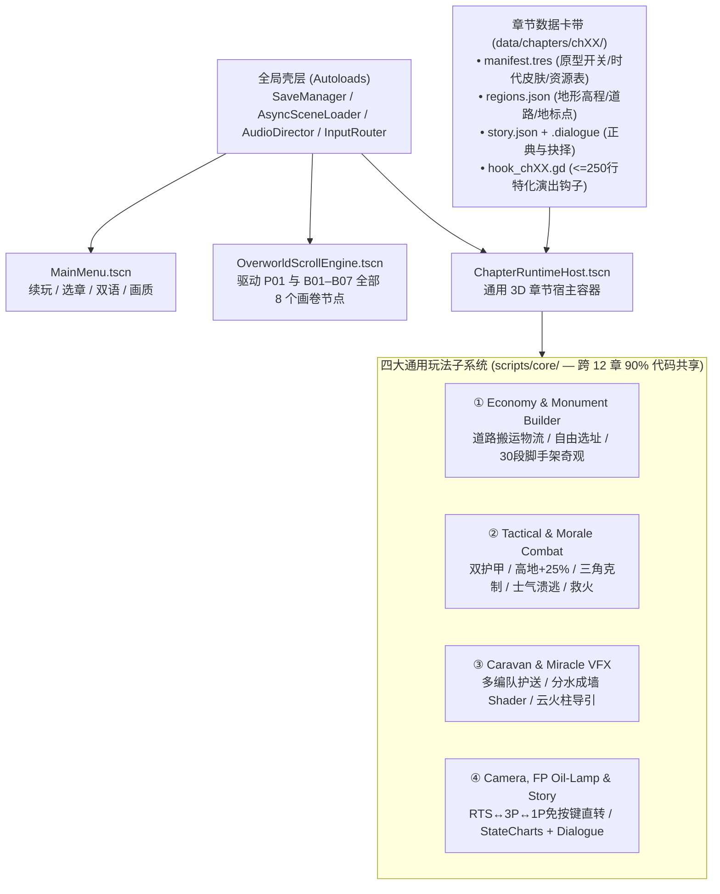

# 《应许之路》全章通用引擎架构与工业化研发技术总案（v6.0）

- **状态（Status）**：`M0 + M1.5 + Phase A 通用卡带底座已实装`
- **引擎与目标平台**：Godot Engine `4.7.2-stable` | Steam 桌面端（Windows/Linux `Forward+`）+ 移动端（Android/iOS `Mobile` 渲染器）
- **配套全章策划书**：[FULL_CAMPAIGN_DESIGN_SPEC_V6.md](./FULL_CAMPAIGN_DESIGN_SPEC_V6.md)
- **单章底层实施细则**：[GODOT_TECHNICAL_ARCHITECTURE_SPEC.md](./GODOT_TECHNICAL_ARCHITECTURE_SPEC.md)
- **Steam 上架专项规范**：[STEAM_RELEASE_READINESS_SPEC.md](./STEAM_RELEASE_READINESS_SPEC.md)

---

## 1. 核心架构哲学：「1 个通用内核 + 20 张数据卡带（Chapter Cartridge）」

面对横跨数千年历史的 **12 个重度 3D 主章 + 8 个交互/纪年画卷节点**，绝不能为每一章重复编写上千行场景、相机、AI 与 UI 代码。全工程采用 **卡带插槽式架构（Cartridge Architecture）**：



**工程红利**：新增任何一个章节（如从 `Ch01 伯特利` 开发 `Ch04 别是巴水井` 或 `Ch07 西乃会幕`），程序员**零重写 UI、零重写寻路、零重写存档**，只需挂载一份 `ChapterManifest` 资源文件与一个不超过 250 行的神迹/特化钩子脚本！

---

## 2. 四大通用玩法引擎子系统技术规格

### 2.1 子系统一：物流扩张与奇观渐进建造引擎（`EconomyAndMonumentSystem`）
支撑 **Type A（`Ch00` 方舟、`Ch07` 会幕、`Ch11` 大卫城下半场）** 与 **Type B（`Ch01` 伯特利、`Ch03` 幔利、`Ch04` 别是巴）**：
1. **统一多时代资源字典**：底层以标签化槽位 `Map<StringName, float>` 运行，通过 `ChapterManifest.visible_resources` 映射为各章显示徽章：
   - `Ch00`：`["timber", "pitch", "provisions", "harmony"]`
   - `Ch01–Ch05`：`["water", "wood", "flock", "stone", "harmony"]`
   - `Ch07`（会幕圣工）：`["acacia_wood", "gold_bronze", "fine_linen", "anointing_oil"]`
2. **《工人物语》式道路图自动搬运（`RoadGraphLogistics`）**：
   - 营地道路存为带权无向图 `AStar3D`（土路权重 `1.0`，铺石路 `0.65`）；
   - 采伐点/水井产出的实体货物包挂载在产出槽，`CarrierAgent` 自动认领最近任务：取货 → 沿 `AStar3D` 走至货栈/奇观工地 → 放下瞬间触发入库结算与 `+N` 浮动跳字。
3. **通用 30 段奇观脚手架建造器（`ProgressiveMonument3D`）**：
   - 任何大型圣工模型（`BLD_NoahsArk.glb`、`BLD_Tabernacle.glb`、`BLD_CityOfDavidWall.glb`）在导出时统一按子网格命名规范 `Step_01 .. Step_30` 与 `Scaffold_01 .. Scaffold_06` 组织；
   - 组件监听 `build_pct (0..100)`，每跨越 `100 / N` 阈值自动显隐下一段构件、播放锤击木屑粒子与 `scale` 弹性落位动效，`100%` 时自动降下拆除全部 `Scaffold_*` 并触发第一人称内部探索区 `Area3D`。
4. **工程先驱插界石扩地与督工光环**：
   - 领土采用 `ShaderMaterial` SDF 圆环并集渲染地面柔和琉璃蓝/金色边界线；
   - 英雄督工组件 `SupervisorAura3D`（用于 `Ch00` 挪亚、`Ch01` 撒莱、`Ch07` 比撒列）：检测 `8m` 半径内工坊/工地，直接注入 `production_multiplier = 1.25 ~ 1.60`。

---

### 2.2 子系统二：古近东战术、高地伏击与士气瓦解引擎（`TacticalCombatEngine`）
支撑 **Type D（`Ch02` 但地夜袭、`Ch09` 耶利哥与艾城、`Ch10` 基甸三百勇士、`Ch11` 攻取锡安保障）** 及和平章的非杀伐防卫（`Ch00` 护木栅、`Ch01` 防群狼、`Ch03` 驱鸷鸟）：
1. **双战斗结算模式开关（`CombatLethalityMode`）**：
   - `NON_LETHAL_MORALE_ONLY`（用于 `Ch00, Ch01, Ch03, Ch04`）：攻击与盾阵对峙仅削减敌方 `morale (100 -> 0)`，归零即触发举手惊呼并沿撤退点 `Run` 溃散，**零尸体、零击杀统计**；
   - `TACTICAL_WARFARE_WITH_MORALE`（用于 `Ch02, Ch06, Ch08, Ch09, Ch10, Ch11`）：启用完整 `HP + 双护甲 + 连锁士气` 双轨制——既可正面交锋，更鼓励通过**夜间火把惊袭、号角齐鸣、侧后包抄（Flanking）**直接打崩敌军全营士气实现以少胜多（完美契合《创 14》318 人夜袭与《士 7》基甸 300 人破敌）！
2. **精确 AoE4 战斗数学模型**：
   - 伤害公式：`Dmg = max(1.0, (BaseAtk + BonusVsTags) * ElevationMul - TargetArmor)`；
   - **高地优势**：若 `Attacker.global_position.y - Target.global_position.y >= 1.8m`，自动赋予 `ElevationMul = 1.25`（艾城伏击战、锡安高地战核心机制）；
   - **防过量集火（Pending Damage Ledger）**：每个单位维护 `incoming_projectile_dmg: float`，远程单位索敌时跳过 `current_hp - incoming_projectile_dmg <= 0` 的目标；
   - **Boids 弧形包抄槽位**：每个近战目标周围预分配 8 个极坐标接战槽，杜绝矛兵挤成一团空转。
3. **高地与夜间战争迷雾（`VFX_FogOfWar.gdshader`）**：
   - 维护一张 `256×256` 动态 `ImageTexture`（`R` 通道=历史已探索，`G` 通道=当前实时视野），支持山脊视线遮挡（高地阻断低处视线，使 `Ch09` 艾城西谷伏兵与 `Ch10` 摩利冈夜袭具备真实潜行博弈）。

---

### 2.3 子系统三：大迁徙车队与神迹天象流体引擎（`CaravanAndMiracleSystem`）
支撑 **Type C（`Ch05` 雅博渡口、`Ch06` 红海分水、`Ch08` 约旦河立碑）**：
1. **百人/百畜低开销编队引擎（`FlockAndCrowdSwarm`）**：
   - 核心可控领队（摩西、约书亚、雅各、利未祭司、族长护卫）使用带完整骨骼的 `CharacterBody3D`；
   - 随行的数百名希伯来百姓与成群牛羊采用 **GPU 顶点烘焙动画贴图（VAT / MultiMesh 帧相位偏移）**，仅占 **2–4 个 Draw Calls** 即可在桌面与手机端同屏流畅呈现壮阔的出埃及与过约旦河大军！
2. **通用分水成墙与溃坝合拢着色器（`shaders/VFX_PartingWaters.gdshader`）**：
   - 一套 Shader 同时驱动 `Ch06 红海分水`、`Ch08 约旦河断流`（并与 `Ch00 洪水` 共享波浪法线核）：
   - 输入统一通道参数 `uniform vec4 corridor_segment`（起点 `XZ`、终点 `XZ`）与 `uniform float parting_progress : hint_range(0.0, 1.0)`：
     - 当 `parting_progress` 从 `0 -> 1` 推进时，通道中心网格顶点下沉露出湿润海床/河床鹅卵石碰撞体（动态启用 `StaticBody3D` 供大军通行），通道两侧边缘顶点隆起 **`+9.5m` 翻滚水墙** 并叠加纵向瀑布泡沫纹理与水雾粒子！
3. **昼夜云柱火柱体积光导引（`PillarOfCloudAndFire3D`）**：
   - 基于体积雾密度场 + `GPUParticles3D` 螺旋上升烟云 + 动态 `OmniLight3D`，白昼呈庄严高耸白金云柱遮阳并阻挡后方战车寻路权重，入夜平滑过渡为熊熊透亮火柱照亮前路。

---

### 2.4 子系统四：全模态相机、提灯第一人称与叙事引擎（`CameraPlayerAndStory`）
1. **三态无缝相机栈（基于 `PhantomCamera3D` 优先级切换）**：
   - `PCam_RTS_Overview`（战略俯瞰 / `[Space]` 战术慢动作派工态）
   - `PCam_Hero_Follow`（第三人称族长/统帅跟随态，带 `SpringArm3D` 防穿墙）
   - `PCam_FirstPerson_Lamp`（第一人称沉浸巡礼态：`MOUSE_MODE_CAPTURED` 免按键直转 + 右下摇曳古陶油灯，通用于**方舟三层船舱、伯特利主帐、幔利星空下、西乃会幕外院、锡安大卫城头**！）
   - `PCam_Cinematic_Beat`（过幕与神迹演出机位：如分水瞬间、耶利哥塌墙、创7:16神手自动封门、亚拉腊彩虹升起，运镜完毕平滑交还玩家机位，**全战役零瞬移硬切**）。
2. **叙事与考据分离引擎（`StoryStageDirector`）**：
   - 解析各章 JSON / `.dialogue`：将 `isAdaptation` 与 `canonRef` 自动推送至右上角 `📜 正典与考据手卷 [J]` 累计解锁词条；底部字幕仅播放纯净角色语音/字幕文本；里程碑抉择直接读写 `SaveManager.campaign_state`。

---

## 3. 全战役共享 3D 美术与模块化派生资产池（控制总包体 `< 450 MB`）

为支撑 12 章跨越上千年的视觉丰富度而绝不让包体失控，采用 **「母体骨骼共享 + 模块化服饰/头饰/器物挂点装配」**：

| 资产大类 | 基础母体数量 | 模块化变体派生方式 | 覆盖全 12 章范围与面数预算 |
| :--- | :--- | :--- | :--- |
| **人类角色与兵种** | **2 套标准 14 骨骼母体**<br/>（男 `1.70m` / 女 `1.58m`，含 `AnimationTree` 14 动作） | 通过 `BoneAttachment3D`（头/胸/左右手/背）+ 材质调色板纹理（Palette/Tint）组合：粗麻袍、琉璃蓝繸边袍、利未细麻以弗得、埃及战车甲、迦南青铜鳞甲、木槌、长矛、投石索、复合弓、瓦瓶火把、羊角号 | 派生 **42 种** 具名英雄、工匠、祭司与敌我兵种；单角色 `< 8,000 tris` |
| **四足写实动物与坐骑** | **7 套 9 骨骼写实动物**<br/>（绵羊、公牛、骏马、牡鹿、雄狮 + 新增灰驴、单峰骆驼） | 统一 `Idle / Walk / Run / StallRest` 动画：既作 `Ch00` 登舟百兽，又作 `Ch01–05` 牧群驴队、`Ch06` 埃及战车挽马、`Ch10` 米甸骆驼营 | 全章通用；经简化后单模型 `< 2.2 MB / < 9,000 tris` |
| **自然地貌扫描件** | **4 套生态气候包（Biomes）** | 复用现有 PolyHaven 崖壁/巨石/橄榄树，通过三平面地形 Shader 切换贴图组：① 亚拉腊高山草甸；② 迦南石灰岩丘陵梯田；③ 南地/西乃红砂砾石旷野；④ 红海/约旦河湿润滩涂 | `MultiMesh` 植被每屏 `< 6` Draw Calls |
| **时代建筑组件库** | **4 套模块化建材 Kit** | ① 上古歌斐木梁板（方舟/木栅）；② 列祖黑山羊毛帐幕与毛石（`Ch01–05`）；③ 出埃及皂荚木包金铜与细麻帷幔（`Ch06–08`）；④ 迦南泥砖夯土城墙与耶路撒冷白石（`Ch09–11`，耶利哥塌墙使用预切块刚体动画） | 全建筑自带 `-col` 静态碰撞与 `LOD` |

---

## 4. 全战役跨章存档与圣约石进度 Schema（`CampaignSaveV3`）

```json
{
  "saveSchemaVersion": 3,
  "profileName": "立约旅人",
  "locale": "zh_CN",
  "unlockedChapterIds": ["ch00_noah_ark", "b01_babel_shem", "p01_leave_ur", "b02_egypt_return", "ch01_bethel"],
  "covenantStonesLit": [1, 2],
  "unlockedCodexEntries": ["GEN_6_14_ARK_CUBITS", "GEN_7_16_GOD_SHUT_DOOR", "GEN_13_8_ABRAM_YIELDS"],
  "carryoverLedger": {
    "noah_harmony_grade": "A",
    "p01_water_bonus": 4,
    "p01_harmony_bonus": 6,
    "ch01_lot_escorted": true,
    "ch02_veteran_retainers": 12,
    "ch06_levite_chorus_unlocked": false,
    "ch08_gilgal_fort_tier": 0
  },
  "activeChapterCheckpoint": {
    "chapterId": "ch01_bethel",
    "eventId": "act3_herdsmen_strife",
    "simSnapshot": {}
  }
}
```

---

## 5. 全季工业化分批交付路线图与 CI 质量门禁（Milestones M0–M4）


| 里程碑 | 交付章节与核心技术攻坚 | 自动化无头 CI (`tests/run_ci.gd`) 强制过关门禁 |
| :--- | :--- | :--- |
| **M0<br/>通用内核与资产瘦身** | • 修复 `GlbAssetLoader` 零泄漏、清理废稿模型、5 种动物减面并注入 9 骨骼四足动画<br/>• 完成 `ChapterRuntimeHost`、物理碰撞层、`PlayerController3D`（CS2 提灯第一人称）、五总线隔音混响、`SaveManager`、`hud_biblical_v3.tscn` 与主菜单 | • 退出 `0 leaked instances`<br/>• `models/` 体积 `< 65 MB`<br/>• 存读档往返快照哈希 100% 一致 |
| **M1<br/>Steam Demo 黄金切片** | • 用 M0 新底座完整升级 **`Ch00` 诺亚方舟**（30段脚手架、实体砍树、救火盾阵、八口具名与四大名场面）<br/>• 串联 **`B01 + P01 + B02` 宏观画卷** → 无缝进入 **`Ch01` 伯特利 `128×96` 七区完整版** | • `Ch00 -> P01 -> Ch01` 全链路通关无报错<br/>• 桌面 `1080p` 与手机 `844×390` / `390×844` 零 UI 重叠、触控键 `>=44px`<br/>• RTX 桌面稳 `120 FPS`、Android 中端机稳 `60 FPS`（Draw Calls `< 120`） |
| **M2<br/>列祖篇全卷贯通** | • 实装 `TacticalCombatEngine`（战争迷雾 + 双护甲 + 夜袭破士气）交付 **`Ch02` 但地夜袭**<br/>• 交付 **`Ch03` 幔利暗夜驱鸷鸟星辰之约**、**`B03`**、**`Ch04` 别是巴勘井水网**、**`B04`**、**`Ch05` 雅博渡口分队涉水**（新增灰驴/骆驼资产） | • 全事件分支 JSON 图遍历 100% 可达、无死锁<br/>• `Carryover` 跨章增益校验通过 |
| **M3<br/>神迹天堑与攻城篇** | • 实装 `VFX_PartingWaters` 分水着色器与百人 VAT 人群，交付 **`B05` + `Ch06` 红海分水**<br/>• 交付 **`Ch07` 西乃会幕 30 段圣工**、**`B06`**、**`Ch08` 约旦河十二石立碑**、**`Ch09` 耶利哥塌墙与艾城高地伏击** | • 分水通道动态碰撞与百人同屏压力测试 `< 8ms/frame`<br/>• 高地 `+25%` 与反过量集火单测全绿 |
| **M4<br/>第一季终章与发行打包** | • 交付 **`Ch10` 基甸三百勇士瓦瓶火把夜战**、**`B07`**、**`Ch11` 锡安大卫之城立体攻城与迎约柜终章**<br/>• 完成 `zh_CN / en_US` 母语级校对、Steamworks 成就接入（12 圣约石）与 Windows / Android 正式导出预设 | • 全 20 节点连续战役自动化冒烟全绿<br/>• 总安装包体积 `< 450 MB`，中英双语零缺失键 |
