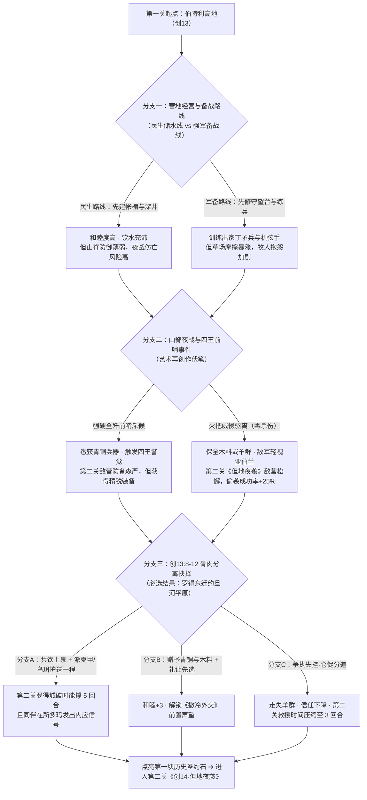

# 《应许之路：十二圣约祭坛》分支叙事与四维策略总体方案（GDD v3.0 · Branching Edition）

**Version:** 3.0 (`Branching Narrative + 12-Stone Altar + 4-Pillar Strategy`)
**Target Platforms:** Web (Desktop `1920×1080`) / Mobile Landscape (`844×390`) / Mobile Portrait (`390×844`) via Capacitor 8
**Target Audience:** 核心 18–45 岁轻中度策略与文化向玩家；扩展 12–17 岁青少年及家庭共玩受众

---

## 一、 核心设计哲学：如何在忠于《旧约》的前提下做出“真分支情节”？

遵循「**经文正典锚点（Canon Anchor）不可反转，历史肌理与同伴分支（Historical & Companion Branches）深度可变**」的原则，游戏采用 **“收束式钻石分支结构（Diamond Branching）+ 跨章因果链（Cross-Chapter Consequence）”**：

---

## 二、 四维策略核心系统（Economy, Camp, Military, Warfare）

1. **策略经营（Economy & Logistics）**：
   - 四大核心资源：`饮水（Water）`、`木料（Timber）`、`石料/青铜（Stone/Bronze）`、`军粮/羊群（Flock）`，外加 `家族和睦/士气（Harmony）` 与 `草场拥挤摩擦值（Friction, 0–100%）`。
   - **昼夜与消耗节奏**：单关时长控制在 **6–12 分钟**（2 轮白昼基建 + 1 轮夜晚危机战 + 1 次经文抉择），每日/每轮根据人口与兵力扣除饮水；罗得羊群会随时间推高草场摩擦。
2. **建造营地（Camp Construction）**：
   - 围绕中心**「十二圣约祭坛」**，地图设有可建造/升级槽位：
     - **黑毛游牧帐棚**：增加人口容量，提供快速体力恢复（建成后回体 `+45`）；
     - **石垒守望台**：预警北侧山脊敌情，夜战时自动投石压制；
     - **兵甲练兵架**：消耗木料/青铜与军粮，招募并训练古希伯来兵种。
3. **建立军事（Biblical Military Units）**：
   - **家丁矛兵**（创 14:14 亚伯拉罕 318 家丁原型）：前排盾矛卡位；
   - **甩石机弦手**（士 20:16 / 撒上 17）：远程精准打击与驱兽；
   - **火把斥候**（创 14:15 / 士 7）：夜间照明破雾、威慑兽群与制造混乱；
   - **复合弓手**（创 21:20）：驻守高地与守望台提供持续远程火力。
4. **战争与定格战术（Real-Time with Pause + Tactical Cards）**：
   - 支持**随时定格沙盘**，拖拽/点选规划多角色与士兵路线，点击执行同步推进；配合与营地真实物资绑定的**情境手牌**（如《兄长的礼让》《山脊火把阵》《机弦齐射》）。

---

## 三、 「十二圣约祭坛」全战役进度与代表性分支情节矩阵

1. **单关微观亮灯**：每关 4 个环节（`立营 → 备战 → 护卫/交战 → 立约`），每完成一环点亮中央祭坛 3 块原石，逐级解锁营地全员光环（回体、攻防、士气）。
2. **宏观 12 章分支脉络**（每章永久点亮 1 块历史圣约石）：
   - **石 01 · 创 13 伯特利分群（第一关）**：分支在于「备战取向」「夜战强硬/驱离」「派谁/送多少物资护送罗得」。
   - **石 02 · 创 14 但地夜袭（第二关）**：分支在于「三路夜间分兵潜行路线」以及战后**「面对撒冷王麦基洗德献饼酒 vs 拒受所多玛王财物（创14:22-23）」**是否额外赎回所多玛被掳平民（影响后续罗得与所多玛城门声望）。
   - **石 03 · 创 21 别是巴七井盟约**：分支在于「武力夺回水井」vs「以七只母羊羔与亚比米勒外交立约」。
   - **石 04–12（出埃及 ➔ 利非订之战 ➔ 耶利哥绕城 ➔ 基甸 300 人夜袭 ➔ 大卫以拉谷/亚杜兰洞 ➔ 希西家水道守城 ➔ 尼希米 52 日边战边修城墙）**：每章均保留经文主干，在**战法路线、内部士气安抚、随行虚构同伴存亡/去留**上提供多分支体验。

---

## 四、 手机端屏幕设置与人机工学规范（Screen Spec）

- **桌面端（`>=1024px`）**：全屏 `3:2` 沙盘 + 角落轻量化悬浮泥板 HUD。
- **手机横屏（`844×390`）**：**左侧 `65%` 场景视口 + 右侧 `286px` 紧凑指令坞**（严禁上下同时压 HUD 条导致中央视口被裁成扁条）。
- **手机竖屏（`390×844`）**：**上方 `52%` 视口 + 下方 `48%` 拇指操作区**，开启**单指拖拽平移 + 选中角色自动居中平滑跟随 + 「泉眼/祭坛/羊群」一键飞镜胶囊**，所有按钮 `>= 44×44 CSS px`。

---

## 五、 工程实施规划（待 Codex 评审后启动）
1. 升级 [src/config.ts](file:///c:/AI/gemini/promise-path-next/src/config.ts) 与 [src/game.ts](file:///c:/AI/gemini/promise-path-next/src/game.ts)，实装「十二石祭坛 4 阶段点亮 + 草场摩擦条 + 守望台/练兵建造 + 夜间双狼/斥候防卫 + 分支结局与跨关状态继承」；
2. 在 [src/World.tsx](file:///c:/AI/gemini/promise-path-next/src/World.tsx) 接入 Codex 生成的 `level1-bethel-ground.png`、6 名角色切片、建成态帐棚、双狼物件及祭坛逐石发光特效；
3. 按手机横竖屏规范重构 [src/App.tsx](file:///c:/AI/gemini/promise-path-next/src/App.tsx) 与 [src/style.css](file:///c:/AI/gemini/promise-path-next/src/style.css)，启动浏览器多视口截图自检。
