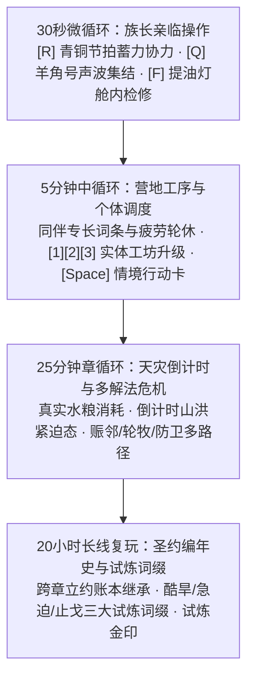

# 《应许之路》对标 Steam Top 10 可玩性深度拆解与商业上架缺陷全量审计

- **状态（Status）**：`Phase A (Gameplay 2.0) 已实装 (Commit f60965b)` · `Phase B/C 规划执行中`
- **关联文档**：[全库文档总索引](./DOCUMENTATION_INDEX.md) · [全章总策划与 20 节点剧情方案](../design/FULL_CAMPAIGN_DESIGN_SPEC_V6.md) · [全章通用技术架构 V6](../design/FULL_CAMPAIGN_TECHNICAL_ARCHITECTURE_V6.md) · [Steam 上架专项合规规范](../design/STEAM_RELEASE_READINESS_SPEC.md)

> [!IMPORTANT]
> **核心客观判断**：`M1.5`（Commit `53d8347`）解决了 **“底层工程骨架能不能跑通（5 层物理、卡带解耦、双语框架、零报错 CI）”** 的问题；在此基础上，`Phase A`（Commit `f60965b`）进一步补齐了 **族长羊角号与节拍蓄力、具名同伴词条与疲劳轮休、三槽实体工坊科技、`[Space]` 战术暂停与写实情境行动卡、大洪水下舱提灯堵漏、伯特利野狼侵袭与历代志试炼词缀**。本报告完整保留对标 Steam Top 10 的设计依据与正式上架 Steam 前仍需攻克的硬性工程清单。

---

## 一、对标基准：Steam 下载/在线榜 Top 10 游戏的核心留存法则

结合 **SteamDB 历史在线峰值榜 Top 10** 与 **VG Insights / Gamalytic 买断制下载保有量 Top 10**（剔除纯挂机点击器异常样本后，纳入同品类策略生存天花板作为直接转译桥梁），提炼出决定一款 Steam 游戏能否破圈的 **10 条底层可玩性铁律**：

| Steam Top 10 标杆作品 | 量级参考（CCU 峰值 / 估算销量） | 核心成瘾与留存机制 | 《应许之路》吸收与落地状态 |
| :--- | :--- | :--- | :--- |
| **1. PUBG: Battlegrounds** | 325.7 万 CCU / 免费下载头部 | **动态空间压缩与紧迫感**：毒圈逼迫玩家在“继续搜刮资源”与“提前转移卡位”之间做高风险取舍 | **Phase A 已接入**：[deterministic_economy_sim.gd](../godot-pilot/scripts/core/deterministic_economy_sim.gd) 实装倒计时归零山洪冲刷惩罚与真实水粮消耗 |
| **2. 黑神话：悟空** | 241.5 万 CCU / ~1,800 万份 | **古典文化母题的电影级视听奇观 + 极致打击反馈 + 影神图叙事考据** | **已实装双语考据手卷 `[J]` + 节拍重锤顿帧**；后续 Phase B 增补真实采样拟音与镜头特写 |
| **3. 幻兽帕鲁 Palworld** | 210.1 万 CCU / ~2,100 万份 | **“主角亲自下场干活 + 个体词条伙伴自动化 + 基地防卫”三位一体循环** | **Phase A 已实装**：族长 `[Q]` 羊角号 + `[R]` 完美协力 + 具名同伴专长词条与体力轮休 |
| **4. Counter-Strike 2** | 186.2 万 CCU / 常年日活第 1 | **零延迟操作手感 + 空间听声辨位 + 经济局风险博弈** | **Phase A 已实装**：第一人称手持陶油灯 + 5 总线舱内混响 + 循急流声下舱涂抹松香封堵渗水缝 |
| **5. 怪物猎人：荒野** | 130.7 万 CCU | **动态生态与天气突变改变底层规则 + 战前营地整备决定成败** | **Phase A 已实装**：暴雨加剧体力消耗，解锁遮雨粮棚/分水石槽/干石羊圈直接改变环境规则 |
| **6. Dota 2** | 129.5 万 CCU | **战争迷雾（Fog of War）视野博弈 + 高低地差 + 资源分配时机窗口** | **待 M2（`Ch02 但地夜袭`）开启**：军事救援章节启用三层战争迷雾与高地 `+25%` 伏击 |
| **7. 赛博朋克 2077** | 105.4 万 CCU / ~2,600 万份 | **无缝第一人称沉浸演出（桌面器物交互、不切黑屏的临场感）** | **Phase A 已实装**：亚伯兰主帐木案新增可提灯研读的《吾珥盟约与牧道泥板》 |
| **8. 艾尔登法环 Elden Ring** | 95.3 万 CCU | **远景地标驱动探索（靠视觉奇观吸引玩家主动走过去）** | 300 肘三层方舟、北岭十二石祭坛与亚拉腊彩虹构成核心远景锚点；后续增补远景群山裙边 |
| **9. 博德之门 3 BG3** | 87.5 万 CCU / ~1,700 万份 | **“失败也是精彩分支（Fail-Forward）”+ 环境元素联动 + 同一危机多解法** | **Phase A 已实装**：既可修木栅盾阵御敌，亦可打 `【开仓赈邻】` 分粮化敌、或勾选 `【止息刀兵】` 和平通关 |
| **10. 泰拉瑞亚 Terraria** | ~3,600 万份（买断制常青树） | **30 秒（采集）→ 5 分钟（造工具/扩建）→ 30 分钟（阶段大事件）三层目标嵌套** | **Phase A 已实装**：`[1][2][3]` 三槽实体工坊设施破土生成，衔接微操与章节奇观合龙 |

> [!TIP]
> **同品类策略生存 Top 标杆转译桥梁**：在 25 分钟章节卡带尺度上，直接融合 **《冰汽时代 Frostpunk》**（倒计时天灾压力）、**《风暴之城 Against the Storm》**（25 分钟单局 + 试炼环境词缀重玩性）与 **《Thronefall》**（白昼建设经济权衡 + 夜晚率队防卫）。

---

## 二、六大高投产比可玩性系统架构（Phase A 已落地于 `scripts/core/`）

在不破坏 **“经文正典主干神圣不可篡改、零神迹抽卡、零礼拜计分”** 红线的前提下，由 [gameplay_v2_director.gd](../godot-pilot/scripts/core/gameplay_v2_director.gd) 与 [gameplay_v2_hud_bar.gd](../godot-pilot/scripts/ui/gameplay_v2_hud_bar.gd) 跨章节统一驱动：

1. **族长亲临技能组（30 秒微循环）**：`[Q]` 吹响羊角号扩散金色声波环（全员提速 `+30%`、恢复体力并震慑劫掠者/野狼）；`[R]` 启动青铜节拍游标，命中金区触发 `PERFECT!` 暴击产出并充能筹备令。
2. **三槽实体工坊科技树（5 分钟中循环）**：`Ch00` 可建 **木滑轮起重架 / 双联松脂熬灶 / 遮雨储粮棚**；`Ch01` 可建 **砌筑分水石槽 / 干石夜间羊圈 / 迎宾织锦凉亭**，3D 建筑在营地实时生成。
3. **具名同伴词条与疲劳轮休**：闪（榫卯）、含（气力）、雅弗（匠心）、撒莱/挪亚之妻（帐棚生计）各自提供专长乘区；体力低于阈值自动前往凉亭轮休恢复。
4. **`[Space]` 战术暂停（`0.0x / 0.35x [P]`）与写实情境行动卡**：消耗筹备令打出 `【引泉浸木】`、`【轮班急造】`、`【开仓赈邻】` 或 `【火把驱狼】`、`【划界轮牧】`、`【商队易物】`。
5. **第一人称提灯核心目标**：`Ch00` 大洪水期间下层船舱出现喷涌渗水缝，需提油灯下舱涂抹松香封堵；`Ch01` 南坡新增迦南野狼群动态侵袭，主帐内可提灯研读《吾珥盟约与牧道泥板》。
6. **历代志试炼模式（Chronicle Trials）**：主菜单可多选勾选 `【示拿酷旱】`、`【洪水急迫】`、`【止息刀兵】` 三大词缀挑战试炼金印章。

---

## 三、正式上架 Steam 前仍待攻克的硬性工程清单（Phase B & Phase C）

### A 类：内容体量与角色差异化（`Phase C · M2–M4`）
1. **扩展主线章节体量**：当前 `Ch00 + P01 + Ch01` 约 **25–35 分钟**，适合作为 **Steam 新品节（Next Fest）免费试玩版 Demo**；抢先体验（EA）建议至少完成第一卷列祖篇（`Ch00–Ch05`，约 4–6 小时），1.0 正式版完成全 12 章（10–15 小时）。
2. **扩充 NPC 服饰与面貌变体**：为雇工、村民、四王联军、迦南行商增补 4–6 套古近东历史服饰配色与胡须头饰变体，消除同模复用感。

### B 类：Steamworks SDK 与 Steam Deck / 手柄绿标审核（`Phase B`）
3. **集成 `GodotSteam`（GDExtension）**：接入 `SteamAPI_Init`、`Shift+Tab` Overlay 自动暂停、**Steam Auto-Cloud 云存档**（同步 `user://saves/`）与 **28–36 枚 Steam 成就**。
4. **完整手柄映射与动态按键图标切换**：为 [chapter_runtime_host.gd](../godot-pilot/scripts/core/chapter_runtime_host.gd) 补齐双摇杆、十字键与肩键绑定，并通过 Steam Input API 在连接手柄/Steam Deck 时动态隐藏键鼠文字（`[E]/[F]/[Space]`）切换为手柄图标。
5. **按平台隔离触控模拟**：桌面端正式导出包关闭 [project.godot](../godot-pilot/project.godot) 中的 `pointing/emulate_touch_from_mouse`。

### C 类：PC 商业版系统设置、视听打磨与发行合规（`Phase B`）
6. **PC 显示与改键菜单**：补齐无边框全屏/窗口化、多分辨率（含 `1280×800` 16:10 与 `3440×1440` 21:9 超宽屏安全框）、垂直同步（VSync）、帧率上限及全键位重映射。
7. **地形远景裙边与 UI 图标精修**：为各章地形外围增补低模连绵群山裙边（Vista Mountain Ring）防止边缘穿帮；为资源徽章绘制高辨识度木/脂/粮/水图形 Icon。
8. **导出管线与合规披露**：编写 `godot-pilot/export_presets.cfg`（务必配置 `include_filter="data/*.json, LICENSES/*.txt"`）、`app_build.vdf` / `depot_build.vdf`、主菜单 `制作人员与开源致谢（Credits）` 页，并在 Steamworks 后台如实填写 **Pre-Generated AI Content Survey** 及预留至少 14 天公开 `Coming Soon` 周期。
